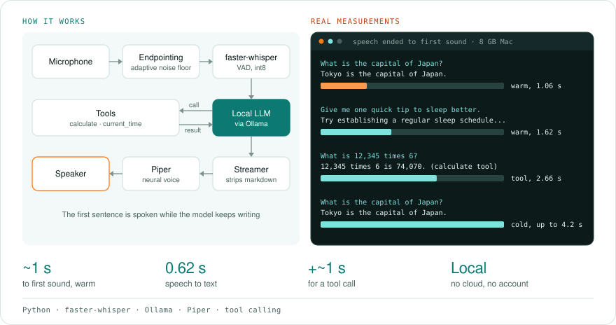
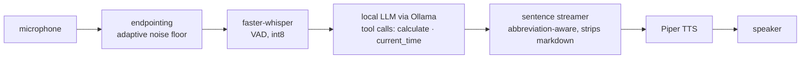

# voice-assistant

**A voice assistant that runs entirely on your computer.** Speak, and it listens, thinks and talks back with a natural neural voice. No cloud, no account, no wake-word service listening on someone else's server. Speech recognition is faster-whisper, the brain is any Ollama model (with tools for exact arithmetic and the current time), and the voice is Piper.

  

<!-- author-banner -->
> **Project 11 of 20** in my AI build series, designed and built by **[Abbishekk DGS](https://abbishekkdgs.tech)**. [See all projects →](https://github.com/Abbishekk-DGS)

<!-- overview:start -->
## Overview

<picture>
  <source media="(prefers-color-scheme: dark)" srcset="docs/overview-dark.svg">
  
</picture>

## Interface

It is one terminal command that listens through your microphone. There is no graphical app.

| Option | What it does | Default |
|---|---|---|
| `--text` | Answers a typed question, skipping speech recognition | |
| `--input` | Answers an audio file, skipping the microphone | |
| `--save` | Writes the spoken reply to a WAV file (with `--text` or `--input`) | |
| `--mute` | Doesn't play audio | off |
| `--stats` | Prints latency for every turn | off |
| `--model` | Ollama chat model | `qwen2.5:3b` |
| `--whisper` | faster-whisper model size | `base.en` |
| `--voice` | Piper voice | `en_US-lessac-medium` |

The terminal shows each spoken sentence and any tool calls. With `--stats` it also shows speech-to-text, first token, first audio and total times.
<!-- overview:end -->

## Results

Spoken questions (recorded with macOS `say`) on an 8 GB Apple Silicon Mac, with `qwen2.5:3b`, Whisper `base.en` and Piper `en_US-lessac-medium`. "First audio" is measured from the end of your speech to the first synthesized sound:

| You said | It answered | Speech-to-text | First audio |
|---|---|---|---|
| "What is the capital of Japan?" (warm) | Tokyo is the capital of Japan. | 0.62 s | **1.06 s** |
| "Give me one quick tip to sleep better." (warm) | Try establishing a regular sleep schedule and creating a relaxing bedtime routine… | 0.63 s | **1.62 s** |
| "What is 12,345 times 6?" | 12,345 times 6 is 74,070. *(via the `calculate` tool)* | 0.62 s | 2.66 s |
| "What is the capital of Japan?" (cold, model loading) | Tokyo is the capital of Japan. | 0.61 s | 2.9–4.2 s |

- **About a second to first sound** once the model is warm. Ollama keeps it loaded for 5 minutes after each turn.
- **Tool calls cost about 1 s extra** (one more model round trip), and buy exact arithmetic.
- **A bug found and fixed on the way:** the first cold run answered *"东京 is the capital of Japan"*. Qwen slipped Chinese characters into English, which an English voice can't pronounce. An explicit English-only rule in the system prompt fixed it in every cold-start retest.
- **The model's knowledge is the limit.** Asked for China's largest city, the 3B model said Beijing (it's Shanghai). Swap in a bigger model with `--model` if you have the memory.

## Why it feels fast: streaming by sentence

A naive assistant waits for the whole reply, then synthesizes it all, then plays it. This one overlaps the stages:

```
LLM thread:      token token token .  token token token .  token token .
                                    ↓ sentence           ↓ sentence
speech thread:              synthesize → play   synthesize → play
```

As soon as the first sentence is complete it goes to the voice, while the model keeps writing the second. Time to first sound is one sentence, not one paragraph. The test suite checks this: the first sentence must be spoken during a pause in generation.

## Pipeline



- **Endpointing** measures the room's noise for 300 ms, starts recording when speech rises 3× above it, and stops after 0.8 s of quiet. No push-to-talk needed.
- **Tool calling.** Small models are bad at arithmetic, so the model calls a `calculate` tool. That tool walks the Python AST and never runs `eval`, so "what's 1234 times 5678?" is exact.
- **Speech-friendly output.** The system prompt asks for short, spoken-style answers. The sentence streamer doesn't split on "Dr." or "3.5", and strips markdown so the voice never reads out asterisks.

## Quickstart

```bash
ollama pull qwen2.5:3b             # https://ollama.com

git clone https://github.com/Abbishekk-DGS/voice-assistant && cd voice-assistant
uv sync

uv run voice-assistant --stats                                 # talk to it
uv run voice-assistant --text "what's 1234 times 5678?" --save reply.wav
uv run voice-assistant --input question.wav                    # answer a recording
```

The first run downloads the Whisper `base.en` model (~140 MB) and the Piper voice `en_US-lessac-medium` (~60 MB). Try other voices with `--voice`; see the [Piper voice list](https://huggingface.co/rhasspy/piper-voices). On macOS, allow microphone access for your terminal.

## Development

```bash
uv sync --extra dev && uv run pytest -q
```

## About the author

Built by **Abbishekk DGS**. More of my work at **[abbishekkdgs.tech](https://abbishekkdgs.tech)** and on **[GitHub](https://github.com/Abbishekk-DGS)**.

## License

MIT © Abbishekk DGS
